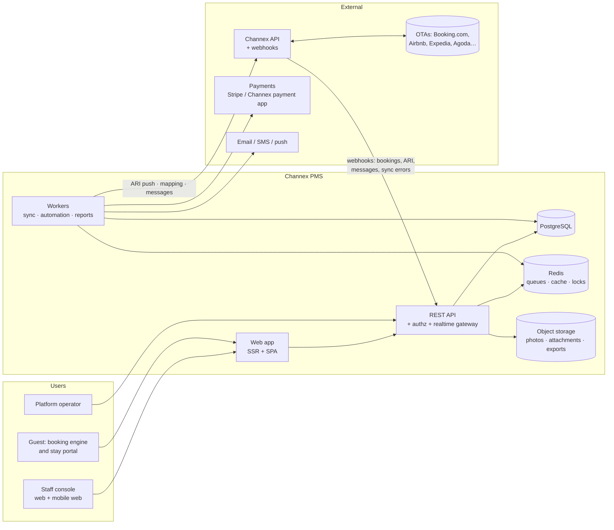
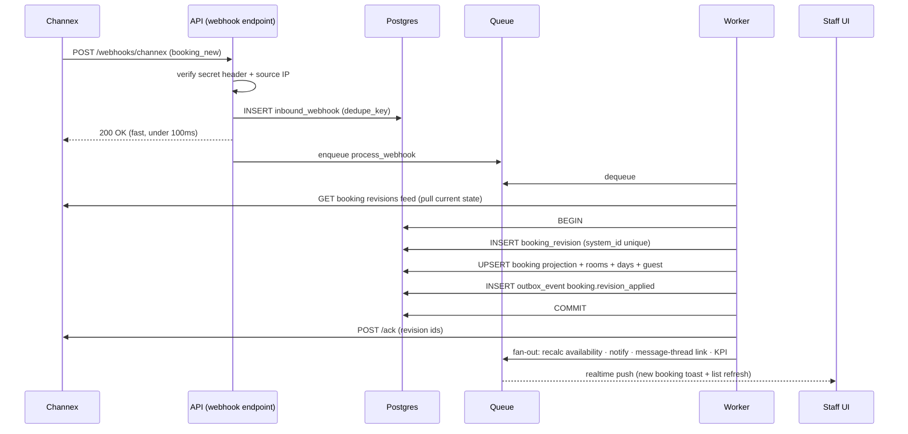
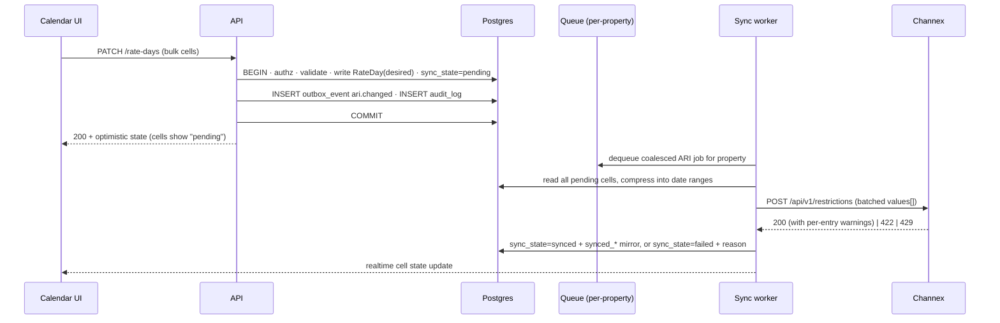

# 04 — Architecture

**Status:** `review` — revised 2026-08-21 to match the D3 stack decision (full-stack Next.js + worker; no separate api app in v1) and the owners/operations modules.

## 4.1 System context



## 4.2 Shape: modular monolith + workers

**Decision (ADR-0001): one deployable API application organised into strict
modules, plus a separate worker process. Not microservices.**

Why: the hard problems here are correctness (never lose a booking, never let ARI
drift) and contributor throughput, not independent scaling of thirty services. A
single Postgres transaction spanning "persist revision, recompute projection,
enqueue availability recalculation" removes an entire class of distributed bugs
that a small OSS team cannot afford to chase.

Modules — each owns its tables, exposes a typed service interface, and may not
import another module's internals:

| Module | Owns |
|---|---|
| `identity` | users, orgs, groups, grants, sessions, SSO |
| `authz` | permission catalogue, evaluation, policy tests |
| `properties` | property, content, policies, taxes, photos, rooms |
| `inventory` | room types, rate plans, availability, rates, restrictions, yield rules |
| `channels` | connections, adapter descriptors, mappings, health |
| `connectivity` | the provider port + Channex adapter + sync engine |
| `reservations` | bookings, revisions, projections, unmapped queue |
| `operations` | turnover tasks, crews, cleaner app, maintenance, blocks, access credentials; front-desk surfaces for hotel-kind |
| `billing_ops` | folios, charges, payments, invoices *(guest-facing money)* |
| `owners` | owners, agreements, statements, expenses, payouts, owner portal |
| `messaging` | threads, messages, templates, automation |
| `reviews` | reviews, responses |
| `insight` | reports, KPI aggregates, exports, saved views |
| `notifications` | preferences, delivery, digests |
| `audit` | append-only log, hash chain |
| `platform` | plans, subscriptions, quotas, operator console *(hosted service; v1)* |
| `plugins` | registry, installation, sandboxed execution |

Cross-module communication is **either** a direct typed call within a request
transaction **or** a domain event via the outbox — never a shared table read.

The escape hatch is deliberate: because modules communicate over interfaces and
events, any one of them can be extracted into its own service later without
rewriting callers. We just refuse to pay that cost on day one.

## 4.3 Ports and adapters

Domain code depends on interfaces; infrastructure implements them.

```ts
interface ConnectivityProvider {
  // provisioning
  ensureGroup(g: GroupSpec): Promise<ProviderRef>
  ensureProperty(p: PropertySpec): Promise<ProviderRef>
  ensureRoomType(rt: RoomTypeSpec): Promise<ProviderRef>
  ensureRatePlan(rp: RatePlanSpec): Promise<ProviderRef>

  // ARI
  pushAvailability(batch: AvailabilityBatch): Promise<PushResult>
  pushRatesAndRestrictions(batch: RestrictionBatch): Promise<PushResult>
  readAri(query: AriQuery): Promise<AriSnapshot>       // for drift detection

  // channels
  getAdapterDescriptor(code: string): Promise<AdapterDescriptor>
  testConnection(s: ConnectionSettings): Promise<TestResult>
  readChannelMappingOptions(s: ConnectionSettings): Promise<MappingOptions>
  createChannel(c: ChannelSpec): Promise<ProviderRef>
  checkReadiness(ref: ProviderRef): Promise<Readiness>
  setChannelActive(ref: ProviderRef, active: boolean): Promise<void>

  // reservations
  listBookingRevisions(cursor?: string): Promise<BookingRevisionPage>
  ackBookingRevisions(ids: string[]): Promise<void>
  getBooking(ref: ProviderRef): Promise<BookingPayload>

  // messaging + reviews
  listThreads(q: ThreadQuery): Promise<ThreadPage>
  sendMessage(m: OutboundMessage): Promise<ProviderRef>
  uploadAttachment(a: AttachmentUpload): Promise<ProviderRef>
  closeThread(ref: ProviderRef, reason: CloseReason): Promise<void>
  listReviews(q: ReviewQuery): Promise<ReviewPage>
  respondToReview(ref: ProviderRef, body: string): Promise<void>
}
```

Also ported: `PaymentProvider`, `NotificationTransport`, `ObjectStorage`,
`SearchIndex`, `GeoLookup`.

Three implementations of `ConnectivityProvider` ship in-repo:

1. **`ChannexProvider`** — production.
2. **`ChannexStagingProvider`** — same code, `staging.channex.io`, used for the
   PMS certification tests.
3. **`FakeProvider`** — an in-memory simulator that models the behaviours that
   actually break us: `429`s, out-of-order webhooks, duplicate revisions,
   partially-valid ARI batches, unmapped bookings, thread assignment races. The
   entire test suite and the demo seed run against it, so contributors need no
   Channex account to work on the platform.

## 4.4 Request and event flows

### Inbound: an OTA booking



Non-negotiables in this flow:

- **Acknowledge the HTTP request before doing work.** A slow webhook handler
  causes retries and duplicates.
- **Persist the raw payload before parsing it.** A parse bug must never lose data.
- **Treat the webhook as a trigger, not as truth** — Channex documents that
  webhooks can arrive out of order, so we always pull current state.
- **Ack only after the transaction commits.** Channex stops re-serving an
  acknowledged revision; acking early is how bookings vanish.

### Outbound: a rate change



## 4.5 Queues

Redis-backed (BullMQ), all jobs idempotent, all with a `dedupe_key`.

| Queue | Concurrency | Notes |
|---|---|---|
| `webhook.ingest` | high | Tiny, fast, never calls Channex synchronously. |
| `ari.push` | **1 per property** | Serialised per property so pushes cannot race. Coalescing window 2–5 s. |
| `booking.process` | medium | Revision application + ack. |
| `booking.ack_sweep` | 1 | Safety net: re-ack anything unacked after 5 min. |
| `messages.sync` | medium | Thread/message pull, send retries. |
| `automation.run` | medium | Scheduled guest messaging, yield rules. |
| `reconcile.ari` | low | Nightly drift detection per property. |
| `reports.build` | low | Aggregate rollups, scheduled exports. |
| `notify.deliver` | high | Email/push/webhook fan-out. |
| `dlq.*` | — | Dead letters, operator-visible and replayable from the UI. |

**Priority rule:** anything that can lose money (booking ingest, ack, ARI push)
outranks anything cosmetic (reports, thumbnails). Under saturation we shed
report jobs, never sync jobs.

## 4.6 Multi-tenancy enforcement

Defence in depth, because a cross-tenant leak is the one bug that ends the project:

1. **Postgres row-level security** on every tenant table, keyed on `org_id` from a
   session variable set per transaction.
2. **A repository layer** that refuses to build a query without a tenant context.
3. **A CI test** that enumerates routes and asserts each rejects a foreign-tenant
   ID with `403`/`404`.
4. **Object storage keys** prefixed `org/{org_id}/…` with signed, short-lived URLs.
5. **Per-tenant encryption keys** for the PII and credentials columns.

## 4.7 API surface

- **REST, versioned by path** (`/v1/…`), JSON, `application/problem+json` errors.
  We choose REST over GraphQL: it caches, it is trivial to consume from a shell
  script, and it keeps authorisation checks on obvious boundaries.
- **Cursor pagination** everywhere (`?cursor=&limit=`, max 200).
- **Idempotency:** all unsafe endpoints accept `Idempotency-Key`.
- **Optimistic concurrency:** `ETag`/`If-Match` on entities; ARI cell writes carry
  a client-side `expected_version` so two revenue managers editing the same
  weekend get a conflict, not a silent overwrite.
- **Our own outbound webhooks** so third parties can build on us, with the
  signing we wish we had received: `X-Signature: sha256=…` HMAC over the raw
  body, plus timestamp and replay window.
- **OpenAPI 3.1 generated from code**, published, and used to generate the TS
  client the web app itself consumes. Dogfooding keeps it honest.
- **Realtime:** WebSocket (SSE fallback) channels scoped
  `org:{id}:property:{id}:{topic}` for calendar cells, inbox, booking feed,
  sync/channel health.

## 4.7a API keys and the operations API

*Persona: the host who runs the business through Claude ([02 §2.2](./02-personas-and-rbac.md#22-personas-and-system-roles)), and any script.*

- **Authentication.** `Authorization: Bearer otab_…` on any `/api/v1` route.
  `withPermission` resolves the key before looking for a session: its SHA-256 goes to the
  `SECURITY DEFINER` function `resolve_api_key` (migration `0030_api_key_resolver`), which
  returns the organization, key and service account and stamps `last_used_at` at most once
  a minute in the same round trip. The request then runs in that organization's tenant
  transaction with the service account's grants, evaluated by the same engine as a person's;
  no step-up ([02 §2.8](./02-personas-and-rbac.md#28-service-accounts)); audit
  `surface = api`. Unknown, revoked or expired: `401 invalid_api_key`.
- **Operations.** What a host does every day is described once, in
  `apps/web/src/server/agent/ops.ts`: permission, scope, input schema (Zod), code. The REST
  route and the MCP tool are two doors onto the same operation; each REST route is a
  one-line `withPermission.route("<permission>", restOptions(op), …)`, and a unit test
  checks that the route's literal permission is the op's own. Writes that change a property
  take its `propertyId` and are scoped to that property.

  | Method and path | Permission | MCP tool |
  |---|---|---|
  | `GET /api/v1/today` | `booking:read` | `get_today` |
  | `GET /api/v1/properties/inventory` | `property:read` | `list_properties` |
  | `GET /api/v1/ari/calendar?firstNight&lastNight&propertyId` (≤ 62 nights) | `ari:read` | `get_calendar` |
  | `PUT /api/v1/ari/prices` | `ari:update_rate` | `set_prices` |
  | `PUT /api/v1/ari/availability` (open/close = stop-sell) | `ari:update_restriction` | `set_availability` |
  | `PUT /api/v1/ari/min-stay` | `ari:update_restriction` | `set_min_stay` |
  | `GET /api/v1/reservations` (views, filters, `q`) | `booking:read` | `list_reservations` |
  | `GET /api/v1/reservations/{id}` | `booking:read` | `get_reservation` |
  | `POST /api/v1/reservations` (direct booking) | `booking:create` | `create_reservation` |
  | `POST /api/v1/reservations/{id}/cancel` (direct only) | `booking:cancel` | `cancel_reservation` |
  | `GET /api/v1/conversations?filter=needs_reply\|all…` | `message:read` | `list_conversations` |
  | `GET /api/v1/conversations/{id}` (audited) | `message:read` | `read_conversation` |
  | `POST /api/v1/conversations/{id}/messages` | `message:send` | `send_message` |
  | `POST /api/v1/conversations/{id}/notes` | `message:send` | `add_note` |
  | `GET /api/v1/reviews?filter=needs_reply\|all` | `review:read` | `list_reviews` |
  | `POST /api/v1/reviews/{id}/reply` | `review:respond` | `reply_to_review` |
  | `GET /api/v1/channels` | `channel:read` | `list_channels` |
  | `GET /api/v1/sync-health` | `ari:read` | `get_sync_health` |

  Range edits take `firstNight` and `lastNight`, both included, because that is how a host
  says it; core `nightRange` turns them into the half-open `DateRange` (rule 5), refuses
  more than 366 nights or 2,000 cells rather than truncating, and the edits go through the
  calendar's own path (`applyCellEdits`: version check, undo record, push queue) with source
  `manual`, so a rate import never overwrites what the host's assistant set. Money is
  integer minor units (`priceMinor`, `totalMinor`). A guest message goes out through the
  same queue as the console's composer (the channel, or email for a direct booking); an
  internal note needs `message:send` here (the console's note composer sits under
  `message:read`) so a read-only key never writes. Reading a conversation does not mark it
  read for the team. Searching reservations by `q` also matches the lead guest's decrypted
  name on a bounded page, since names are sealed in SQL. The existing per-cell routes
  (`PATCH /api/v1/ari/rates`, `/restrictions`, `POST /api/v1/ari/bulk`, `GET
  /api/v1/ari/grid`, `GET|POST /api/v1/properties`) stay as they were. The OpenAPI document
  lists the operations from the same table; `@channex-pms/sdk` has a method for each.
- **Settings → API & AI** (`/settings/api`): create a key (name, access level), shown once
  with a copy button; the list shows name, access, visible prefix, created, last used and
  creator, with Revoke; and how to connect Claude Code, Claude Desktop, claude.ai and curl,
  with copy buttons, built on `NEXT_PUBLIC_APP_URL` and filled with the new key right after
  creation.
- **Decision (2026-11-10): writes execute directly while the product is in test.** No preview
  or confirm step between the assistant and the calendar, the inbox or a booking: what
  Claude calls happens, permission-checked and audited, as if the host had clicked it. The
  MCP tools carry `readOnlyHint`/`destructiveHint` annotations so the client asks the person
  before a destructive one, and the server instructions tell the model to act only on the
  host's request. A preview mode (dry run returned to the model, a person confirms in the
  console) is the candidate for general availability.

## 4.7b MCP server for AI assistants

*Persona: the host who runs the business through Claude.*

- **Endpoint** `POST /api/mcp`: the Model Context Protocol over Streamable HTTP, stateless
  (a fresh `McpServer` and `WebStandardStreamableHTTPServerTransport` per request from
  `@modelcontextprotocol/sdk`, JSON responses, no session id). Auth: `Authorization: Bearer
  otab_…`; for clients that cannot send a header (a claude.ai custom connector without
  OAuth), the key may be the last path segment, `/api/mcp/<key>`. That URL is a secret and
  the settings page says so in red. No key, or a dead one: `401 invalid_api_key` with
  `WWW-Authenticate: Bearer`. The route is `publicRoute("mcp")` because the transport itself
  carries no permission; the key is resolved once per request and every tool runs inside
  `withPermission` as that key, so permission, scope, audit (`surface = mcp`) and tenant
  isolation are exactly the REST path's. The 401 carries `WWW-Authenticate: Bearer
  realm="otabridge", resource_metadata="<app>/.well-known/oauth-protected-resource/api/mcp"`
  (plus `error="invalid_token"` when a bearer was sent), which starts the sign-in below.
- **Tools** are the operations of §4.7a, one each, with descriptions written for the model
  (ids come from `list_properties` and `get_today`; money in minor units; dates YYYY-MM-DD).
  A refusal is a tool result with `isError: true` that names the missing permission, the
  key's access level and the level that would allow it, so the model can tell the host what
  to change, never a protocol error. Validation and domain errors come back the same way.
- **Sign in with OTAbridge** (OAuth 2.1, the MCP authorization spec of 2025-06-18). OTAbridge
  is both the resource server and the authorization server; the issuer is
  `NEXT_PUBLIC_APP_URL`. Rules in `@pms/core` (`agent/oauth.ts`), endpoints in
  `apps/web/src/server/oauth.ts` behind `publicRoute("oauth")` adapters.
  - *Discovery.* `GET /.well-known/oauth-protected-resource` and
    `/.well-known/oauth-protected-resource/api/mcp` (RFC 9728): `resource` =
    `<app>/api/mcp`, `authorization_servers` = [`<app>`], `bearer_methods_supported`
    [`header`], `scopes_supported` [`mcp`]. `GET /.well-known/oauth-authorization-server`
    (RFC 8414): authorization, token, registration and revocation endpoints; response type
    `code`; grants `authorization_code`, `refresh_token`; PKCE `S256` only; client
    authentication `none` (public clients), `client_secret_post` or `client_secret_basic`;
    `authorization_response_iss_parameter_supported`. Both are rewrites (next.config.ts) onto
    `/oauth/metadata/*`. Metadata, registration, token and revocation answer CORS (`*`).
  - *Registration* `POST /oauth/register` (RFC 7591, JSON): redirect URIs must be `https`, or
    `http` on `localhost`/`127.0.0.1`/`[::1]` (desktop and CLI clients); no fragment, no
    credentials, at most ten; no allowlist of hosts (`https://claude.ai/api/mcp/auth_callback`
    and `https://claude.com/api/mcp/auth_callback` pass the rule like any other). Returns
    `client_id` (`otab_client_…`), and a `client_secret` only for a client that asked for a
    secret-based method (stored as its SHA-256). At most 20 registrations per address per
    hour (429). Table `oauth_client` (global).
  - *Authorization* `GET /oauth/authorize`, a page in the sign-in layout. An unknown
    `client_id` or a `redirect_uri` that is not exactly a registered one (a loopback URI may
    change port, OAuth 2.1 §8.4.2) shows an error and never redirects. Otherwise protocol
    errors go back to the client: `response_type` must be `code`, `code_challenge` with
    `code_challenge_method=S256` is required, `resource` (RFC 8707), when sent, must be
    `<app>/api/mcp` (`invalid_target`). `state` is echoed whenever sent; it is optional,
    because PKCE carries the CSRF protection and some SDK clients omit it. Not signed in: the
    proxy (or the page) sends the person to `/login?next=…` and back; the login and two-factor
    forms follow `next` only when it is a same-site path. The consent screen names the client
    and its redirect host ("Claude (claude.ai)", or "on this computer" for loopback), lets the
    person pick the organization (only those where they hold `api_key:create`) and the access
    level (the four of §4.7a, Full access preselected). Approve is
    `withPermission("api_key:create")` in the picked organization (the `org` option of
    `withPermission`, a person only; membership is still the grant check): it creates a
    service account named after the client with the level's permissions narrowed to the
    approver's own, the consent row `oauth_grant` (org-scoped, RLS), and a single-use code
    (`otab_oac_…`, SHA-256 at rest, 5 minutes, table `oauth_code`, global) bound to client,
    redirect URI, PKCE challenge, resource and service account; the browser then goes to
    `redirect_uri?code&state&iss`. Deny goes to `redirect_uri?error=access_denied&state&iss`.
  - *Token* `POST /oauth/token` (form-encoded). `authorization_code`: the code is consumed
    atomically on first presentation; then client, redirect URI, expiry, resource and
    `BASE64URL(SHA256(code_verifier)) = code_challenge` are checked. Any failure is
    `invalid_grant` and withdraws the consent (the code is burned); a second presentation is a
    replay and also revokes every token the first one issued. Success returns `access_token`
    (`otab_oat_…`: an `api_key` row with `expires_at` one hour on, so `resolve_api_key` and
    `withPermission` take it unchanged), `token_type` `Bearer`, `expires_in` 3600,
    `refresh_token` (`otab_ort_…`, SHA-256 at rest, 60 days, table `oauth_refresh_token`,
    global) and `scope` `mcp`, with `Cache-Control: no-store`. `refresh_token`: one-time
    rotation; a rotated token presented again revokes the connection (OAuth 2.1 §4.3.1).
    Errors are RFC 6749 JSON; an unknown client or a bad secret is `401 invalid_client`.
    Issuing a token clears that connection's expired access tokens.
  - *Audience.* An access token is for the MCP server only (RFC 8707): `/api/v1` answers
    `401 invalid_api_key` to one, and `/api/mcp/<key>` refuses one in the path (tokens never
    travel in a URL).
  - *Revocation* `POST /oauth/revoke` (RFC 7009): a refresh token ends the whole connection, an
    access token ends itself; unknown tokens and another client's tokens get the same 200.
  - *Settings → API & AI › Connected apps*: name, access, connected on, last used, approved
    by, and Disconnect (`withPermission("api_key:revoke")`), which revokes the consent, the
    service account and its grant, every access token and every refresh token at once. The
    connections' access tokens are not listed as keys. The activity log reads "via Claude
    (claude.ai)" (the audit actor carries `via: "app"`); a refused tool tells the model to
    disconnect and connect again with the access that would allow it.
- **Connecting.** claude.ai (recommended): Settings → Connectors → custom connector with
  `<app>/api/mcp`, then sign in and approve. Claude Code: `claude mcp add --transport http
  otabridge <app>/api/mcp --header "Authorization: Bearer <key>"`. Claude Desktop:
  `mcp-remote` in `claude_desktop_config.json` with the header from an environment variable.
  The key-in-URL form `<app>/api/mcp/<key>` stays, documented as a fallback only.

## 4.8 Deployment topology

| Target | Contents |
|---|---|
| **Docker Compose** (default, self-host) | `web`, `worker`, `migrate`, `postgres`, `redis`, `minio`, `caddy` (ADR-0002: no separate `api` app). One `.env`, one command, seedable demo data. |
| **Helm chart** (portfolio / SaaS) | Separately scaled `web` and `worker` deployments, HPA, managed Postgres/Redis/S3, external secrets. |
| **Single-container demo** | For evaluation only; SQLite is explicitly *not* supported — the ARI model needs Postgres. |
| **Cloudflare Workers** (hosted service, ADR-0008) | `apps/web` via OpenNext, `apps/worker-cf` on Queues + Cron Trigger + a Durable Object lease, Neon Postgres behind Hyperdrive, Resend for mail. Same packages, no Redis; realtime polls. |

Configuration is environment variables only (12-factor), validated at boot with a
schema; the process refuses to start on invalid config rather than failing at 3am.
Migrations run as an explicit job, never implicitly on boot.

## 4.9 Observability

- **OpenTelemetry** traces across HTTP → queue → provider call. A trace ID is
  shown in the UI on every error so a hotelier can paste it into an issue.
- **Metrics that matter** (all labelled by property):
  `ari_push_latency_seconds`, `ari_cells_pending`, `ari_drift_cells`,
  `booking_ingest_lag_seconds`, `booking_unacked_count`,
  `webhook_processing_failures`, `channel_state`, `message_first_response_seconds`,
  `queue_depth`, `provider_429_total`, `provider_error_total`.
- **SLOs:** ARI push p95 < 60 s · booking visible in UI p95 < 30 s from webhook ·
  unacked revisions older than 10 min = 0 · webhook endpoint availability 99.9%.
- **Alerts** route to the operator console *and* the affected tenant when the
  cause is tenant-side (expired OTA credentials, a channel disconnected by the
  OTA, mapping gaps).
- **Structured logs** with `request_id`, `org_id`, `property_id`, `actor`. PII is
  never logged; a CI check greps for known-sensitive field names in log calls.

## 4.10 Repository layout

```
apps/
  web/            Next.js — staff console, booking engine, guest portal,
                  owner portal, webhook receiver, public REST API v1
  worker/         queue consumers, schedulers, realtime gateway
packages/
  core/           domain entities, value objects, money, dates
  authz/          permission catalogue + evaluator (generated from spec 02)
  db/             schema, migrations, repositories, RLS policies
  connectivity/   provider port + channex adapter + fake provider
  sync/           ARI diffing, coalescing, drift detection
  ui/             (superseded: the kit lives in apps/web/src/components/ui, ADR-0011)
  sdk/            generated public API client (Apache-2.0)
  testkit/        fixtures, property-based generators, scenario runner
docs/
  specs/          this directory
  adr/            architecture decision records
  runbooks/       operator procedures (see spec 12)
```

## 4.11 Testing strategy

| Layer | Approach |
|---|---|
| Domain | Unit tests; **property-based tests** for ARI diffing, date-range compression, derived-rate computation and money maths. These are where the subtle bugs live. |
| Authz | A generated matrix test: every (role × permission × scope) combination asserted against spec 02. |
| Integration | Real Postgres + Redis in containers; `FakeProvider` for connectivity. |
| Contract | Recorded fixtures of real Channex responses, replayed; a scheduled job runs the live suite against `staging.channex.io` to catch upstream drift. |
| Chaos | Scenario runner injects duplicate webhooks, out-of-order revisions, `429` storms, mid-batch `422`s, and provider outages. Asserted invariant: **no booking lost, no ARI cell permanently wrong**. |
| E2E | Playwright over the critical journeys: onboard property → map channel → change rate → receive booking → message guest → check in. |
| Certification | The Channex PMS certification tests are a first-class CI target before any production release. |
